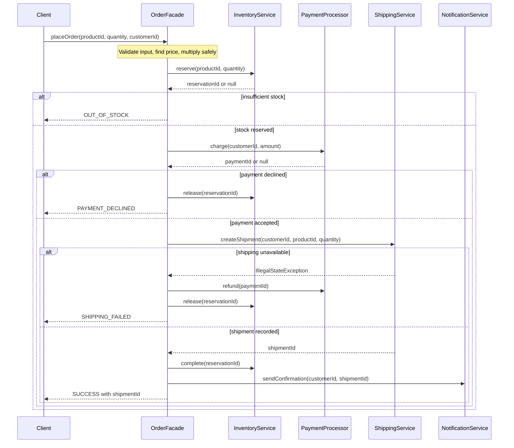

# Order sequences

Invalid inputs throw `IllegalArgumentException`; unknown products return `UNKNOWN_PRODUCT`.
Price multiplication overflow throws `ArithmeticException`. All these paths occur before
reservation, so they change no subsystem state. The in-memory services run sequentially;
this is compensation in a local simulation, not a distributed database transaction.
