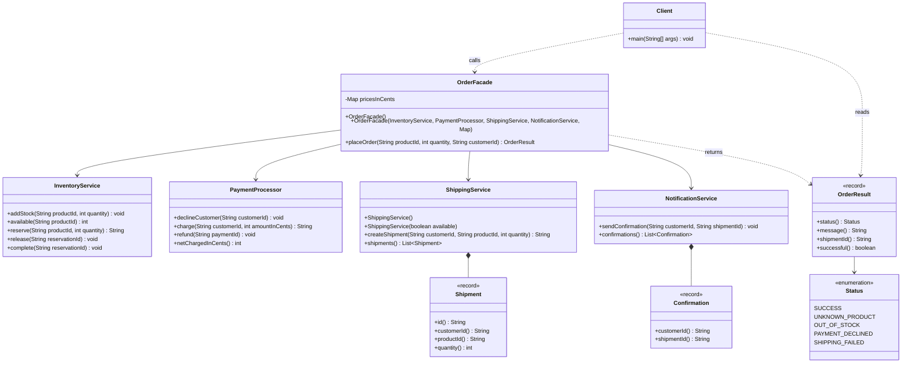

# Class diagram

This diagram shows the implemented public API. `Checks` is a package-private validation helper.
`Reservation` is private inventory bookkeeping. Prices are an immutable map owned by the facade.

Arrow direction matters: no subsystem depends on `OrderFacade`. Advanced clients can
construct, call, and inspect the subsystems directly; the tests demonstrate that use.
